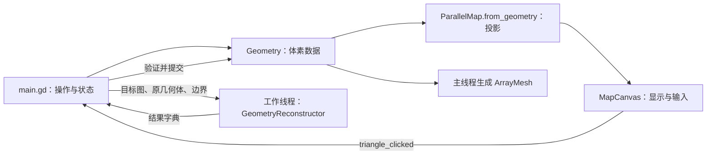

# 2026-10-30｜首版白模与几何重建系统

日期：2026-10-30（北京时间）  
环境：Godot 4.7.2，Windows，GDScript，GL Compatibility。

本日交付可运行的白模与可复用的投影、重建模块，打通“体素数据 → 轴测图编辑 → 新体素数据”的完整链路。玩家、目的地和自由旋转等后续扩展见 2026-11-03 的日志。

## 一、项目架构与模块边界

工程入口为 `project.godot`，主场景为 `res://test/main.tscn`。场景文件仅保留一个挂载 `main.gd` 的根 `Control`；界面和三维节点通过 `_build_interface()`、`_build_world()` 在运行时创建。

| 模块 | 职责与主要接口 |
| --- | --- |
| `script/geometry.gd`：`Geometry : RefCounted` | 体素数据、连接分量、边界、实体及折边网格。入口包括 `duplicate_geometry()`、`connected_components()`、`is_face_connected()`、`build_mesh()`、`build_outline_mesh()` |
| `script/parallel_map.gd`：`ParallelMap : RefCounted` | 四向坐标变换、精确投影、三角格数据。入口包括 `from_geometry()`、`footprint()`、`triangle_columns()`、`projection_equal()` |
| `script/geometry_reconstructor.gd`：`GeometryReconstructor : RefCounted` | 独立的重建入口与内部求解器，不读取 UI，不创建场景或渲染对象 |
| `test/main.gd` | 白模控制器，持有当前几何体、轴测图、模式、线程与操作历史，负责验证结果并提交显示 |
| `test/map_canvas.gd` | 继承 `Control`，通过子 `Node2D` 绘制轴测图和处理拾取，以 `triangle_clicked(key)` 信号上报输入 |
| `test/snapshot_store.gd` | 白模 JSON 存档与快照序列化，不被核心重建模块依赖 |
| `test/validation/` | 核心算法、场景交互与渲染验证入口 |

依赖方向为 `test → script`，核心模块不反向引用白模。正式项目可复用 `script` 下的三个类；当前 UI、历史记录和运行流程仍集中在 `main.gd`，尚未拆成独立的游戏状态机。



## 二、数据格式与坐标约定

### Geometry

- `voxels: Dictionary` 以 `Vector3i(x, y, z)` 为键，值为 `true`；没有该键表示空体素。
- 使用 Godot 的 Y 向上坐标。体素坐标表示单位立方体的最小角，单块占据 `[cell, cell + Vector3i.ONE]`。
- 连接性只按六个轴向相邻体素计算；角接触或棱接触不算连接。空几何体不视为合法的连续物体。
- `sorted_cells()` 按 x、y、z 排序，供投影、网格与搜索使用，减少字典遍历顺序对结果的影响。

### ParallelMap

- `triangles: Dictionary` 的键为 `Vector3i(a, b, half)`，`half` 为 0 或 1，表示一个斜坐标单元内的两个三角形。
- 值为 `RIGHT = 0`、`LEFT = 1`、`TOP = 2`；空白用缺少键表示，不使用第四种颜色值。
- `view_index` 范围为 0～3，表示绕 Y 轴的四个上方等轴测视角。
- 局部投影坐标为 `a = x - y`、`b = z - y`；二维显示为 `(sqrt(3)/2 × (a-b), (a+b)/2)`。深度为 `x+y+z`，数值越大越靠近观察者。
- `from_geometry()` 按深度从前到后处理体素；每块产生六个投影三角格，已经被前方体素写入的格子不再覆盖。
- `world_to_view_cell()` 与 `view_to_world_cell()` 旋转的是立方体的最小角坐标，因此负向旋转包含 `-x-1` 一类补偿。不能直接用点坐标的旋转公式替换。
- 朝向标签来自几何关系，与三维灯光和显示颜色解耦。

## 三、重建接口与求解流程

核心调用为：

```gdscript
GeometryReconstructor.reconstruct(
    map: ParallelMap,
    original: Geometry,
    min_cell: Vector3i,
    max_cell: Vector3i,
    options: Dictionary = {}
) -> Dictionary
```

边界包含两端。当前白模使用 `(-3, 0, -3)` 至 `(3, 6, 3)`，共 343 个允许体素位置；核心接口支持传入其他有限边界。

`options` 的主要参数：

| 参数 | 含义 |
| --- | --- |
| `required_cells` | 必须存在的世界坐标体素，可传数组或以体素为键的字典 |
| `forbidden_cells` | 禁止存在的世界坐标体素，格式同上 |
| `time_budget_ms` | 本次调用的时间预算；核心默认 5,000 毫秒，负值表示不限制 |
| `max_search_nodes` | 连接性搜索节点上限；核心默认 10,000，负值表示不限制 |

求解分为四步。

1. **建立候选列。** 从目标三角格找出可能覆盖它的立方体列，将列与边界相交，枚举允许的前端位置。会向目标空白区产生投影的列被排除。
2. **求投影的最低改动方案。** 每列选择空列或一个前端。三角格朝向确定应当位于最前面的列，并形成列间深度约束。列内阈值与改动代价被转为最小割问题，由内部 `FlowGraph` 使用 Dinic 最大流求解。
3. **处理面连接。** 如果结果不连通，选取一个连接分量及分量内外各一个体素，分支尝试删除其中一个体素，或强制加入该分量的某个相邻边界体素。通过代价下界剪枝，并缓存已搜索的必留/禁用条件。
4. **复查投影并输出。** 每个可输出的连续候选都重新投影，与完整目标图逐格比较。搜索完成后才宣告最优或无解。

对选定前端，原有的后方体素默认保留，前方体素删除，缺少的前端体素补上；必留和禁用条件可以改变这项选择。连接性分支会促使求解器进一步增加、删除或移动前端。改动代价为：

`新增体素数量 + 删除体素数量`

同代价结果通过固定的列顺序、图构建顺序和分支顺序选择，保留首先找到的结果；没有另行定义“所有最优解中的全局字典序最小解”。

### 结果协议

返回字段为 `status`、`geometry`、`edit_cost`、`optimal`、`message`、`stats`。

| status | 调用方的处理要求 |
| --- | --- |
| `optimal` | 已证明改动最少，可以提交 |
| `feasible` | 返回合法连续几何体，但预算耗尽，尚未证明最优 |
| `budget_exceeded` | 尚未找到可输出结果，不能判定无解 |
| `infeasible` | 已确认当前边界及约束下无解 |
| `invalid_input` | 坐标、朝向或边界等输入无效 |
| `internal_error` | 内部投影复查失败，不输出几何体 |

`stats` 包括 `columns`、`candidate_cells`、`search_nodes`、`min_cut_calls`、`flow_augmentations`、`pruned_branches`、`elapsed_ms`，便于定位候选范围过大或连接性搜索过深的问题。

## 四、Godot 场景与线程接入

三维显示使用 `SubViewportContainer → SubViewport → Node3D`，`SubViewport.own_world_3d = true`。世界内分别放置实体与折边的 `MeshInstance3D`、正交 `Camera3D` 和环境节点，二维轴测画布与三维容器在同一显示区域内切换。

- `build_mesh()` 只生成邻格为空的外露方形面，输出带法线、UV、索引的 `ArrayMesh`。Godot 外侧正面使用顺时针顶点绕序。
- `build_outline_mesh()` 汇总外露面的边及法线，只输出折边；共面体素接缝与方形面内的三角剖分线不显示。折边使用 `Mesh.PRIMITIVE_LINES`。
- 吸附相机采用正交投影，上方四视角的方向为 `(±1, 1, ±1)`，仰角约 35.264°。相机根据所有体素角点的投影范围自动居中并调整视野。
- 提交求解时复制 `ParallelMap` 与 `Geometry`，交由 `Thread` 处理。工作线程仅操作数据，不访问场景树，也不调用网格构建方法。
- `_process()` 轮询线程完成状态，使用 `wait_to_finish()` 回收结果，再在主线程验证、替换几何体并更新网格。`_exit_tree()` 会等待已启动线程结束；当前没有独立的取消令牌。

当前交互预算为普通搜索 4,500 毫秒 / 2,200 节点，延长搜索 15,000 毫秒 / 12,000 节点。“延长搜索”会重新调用求解器，不会恢复上一次搜索栈。

## 五、编辑事务与状态恢复

- `main.gd` 使用 `map_mode` 和 `is_busy` 控制几何体、编辑、求解中的可用操作。
- 进入编辑时保留原几何体副本及快照；本轮改动不会立即改写三维几何体。
- `stroke_history` 记录每次修改前的格值，十次有效编辑用完后仍可撤销；相同值的重复点击不计数。
- 只有提交成功后才把进入本轮前的快照加入 `cycle_history`，历史上限为三十轮。取消编辑不增加历史。
- 存档位于 `user://isometric_maze_whitebox/session.json`，顶层保存 `version`、`current`、`history`。初版快照包含 `cells`、`view`、`seed`。
- 当前存档保存已提交几何状态和整轮历史，不保存未提交的轴测编辑、自由观察角度或求解线程状态。

## 六、验证与接入注意事项

本日建立 `core_validation.gd` 与 `ui_validation.gd`，覆盖独立投影对照、小范围穷举最优解对照、网格构建、撤销及实际场景交互。最近一轮回归结果记录在 2026-11-03 的日志中，避免将覆盖后的结果文件误记为首日结果。

后续接入时需要保留以下边界：

- `Geometry.is_face_connected()` 检查的是实体连接，不代表玩家可以走通。
- 连接性分支在复杂输入上可能显著增加搜索量，整个重建算法不能按一次线性扫描估算。
- 白模允许明确采纳未证明最优的有效解；正式关卡的稳定回放应使用已证明最优的结果。
- `Geometry` 同时提供数据与网格构建接口，但只有数据操作可以进入当前求解线程。
- 核心对非空连续几何体求解，空轴测图返回无解。

