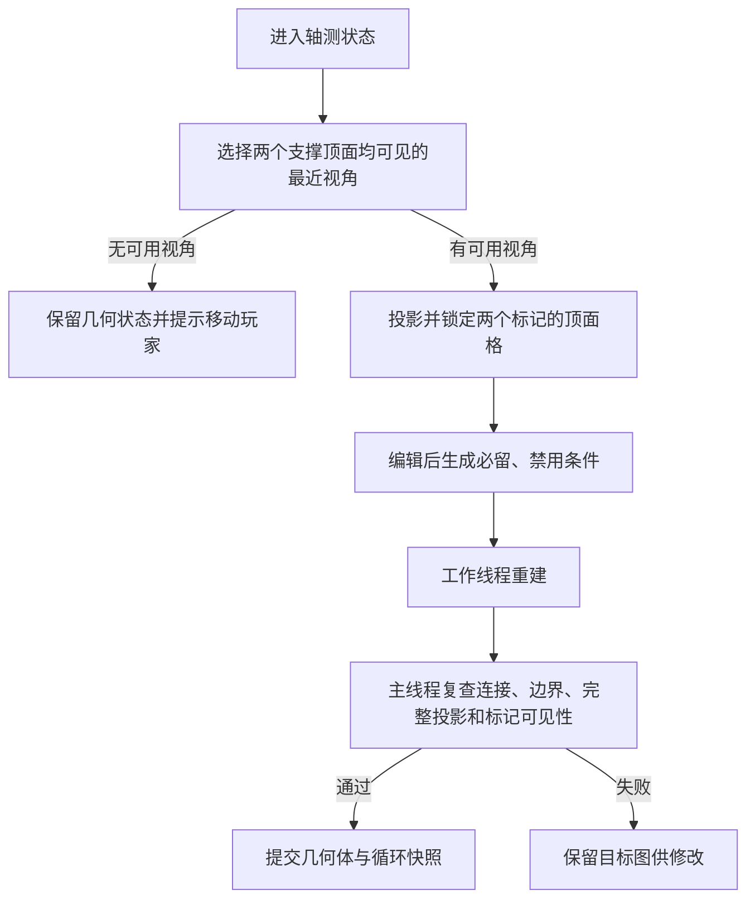

# 2026-11-03｜自由旋转、三角格增删与玩家目的地系统

日期：2026-11-03（北京时间）  
环境：Godot 4.7.2，Windows，GDScript，GL Compatibility。  
基础架构见 [2026-10-30 开发日志](2026-10-30_首版白模与几何重建系统.md)。

本日完成自由观察与吸附、投影轮廓增删、玩家移动及标记保护，将玩家站位接入重建约束。重建器继续使用原有必留/禁用接口，没有引入对白模角色节点的依赖。

## 一、涉及模块与新增接口

| 模块 | 本次改动 |
| --- | --- |
| `test/main.gd` | 新增轨道相机状态、三种编辑模式、玩家与目的地支撑坐标、移动规则、可见视角选择和标记约束合并 |
| `test/map_canvas.gd` | 增加空格拾取、轮廓增删预览、编辑范围、标记、平移缩放与稳定的坐标变换 |
| `script/parallel_map.gd` | 新增 `top_face_keys()`、`top_face_visible()`、`top_marker_constraints()`，将玩法保护转为几何条件 |
| `test/snapshot_store.gd` | 存档格式升级为第二版，快照增加玩家和目的地支撑坐标，兼容第一版读取 |
| `test/validation/` | 新增标记专项验证，并扩充真实输入与场景回归 |

角色与编辑事务目前仍由 `main.gd` 管理。玩家是离散体素顶面上的逻辑位置，显示节点是 `MeshInstance3D`；本次没有引入 `CharacterBody3D`、导航网格或物理碰撞控制器。

## 二、自由观察与正等轴测吸附

轨道相机以 `_orbit_angles: Vector2` 记录水平角与仰角，绕几何体中心旋转；修改的是相机姿态，体素世界坐标保持固定。

- `_input()` 接收三维区域内的左键或右键拖动。鼠标相对位移乘以 0.009 更新角度，仰角限制为 -88°～88°，允许从下方观察。
- 松开鼠标时，`_nearest_view()` 用观察方向与四个标准方向的点积选择最近视角。
- `_finish_orbit_drag()` 使用 0.26 秒的 `Tween`、三次缓出及最短水平转角过渡到标准姿态。再次拖动时停止旧 Tween。
- 松开事件在全局输入中处理，避免鼠标移出三维区域后无法结束拖动；失去应用焦点也会结束拖动。
- 相机保持 `PROJECTION_ORTHOGONAL`，Q/E 和按钮仍可直接切换四向视角。
- 按钮设置 `Control.FOCUS_NONE`，修正点击按钮后方向键被 UI 焦点消耗的问题。

`DirectionalLight3D` 挂在相机下，以保持屏幕左上方向的明暗关系。本轮关闭 `shadow_enabled`，消除无地面白模中的自阴影伪影；实体保留受光材质，玩家与目的地采用不受光材质提高辨识度。

## 三、三角格增删与统一编辑记录

`EDIT_PAINT = 0`、`EDIT_ADD = 1`、`EDIT_DELETE = 2` 分别对应改色、增加、删除，快捷键为 4/5/6。三色画笔快捷键 1/2/3 分别为上、左、右。

| 入口 | 前置条件 | 写入行为 |
| --- | --- | --- |
| `paint_triangle(key, orientation)` | 格子已存在、朝向有效 | 替换朝向 |
| `add_triangle(key, orientation)` | 格子为空且在允许编辑集合内 | 插入键值 |
| `delete_triangle(key)` | 格子已存在 | 删除键 |

三个入口统一经过 `_edit_triangle()`，再由 `_set_triangle()` 写入 `ParallelMap`。笔画记录为 `{key, before}`，其中 `before = null` 表示修改前为空，所以同一套撤销能够处理三类操作。

- `stroke_history.size()` 即本轮已用额度，上限十次；撤销弹出一条记录并恢复原值。
- 无变化操作不记录，受保护格不允许修改；修改和撤销均清空旧的待采纳结果，防止提交过期解。
- `_editable_triangle_keys()` 将当前视角下允许边界内所有体素的六格投影合并为有限编辑集合。它限制可点击范围，不承诺任意编辑都能重建。
- 空格不写入三角数据；完整空白约束仍由重建器检查，轮廓改变不会绕过投影一致性验证。

### 画布坐标与拾取

`MapCanvas` 使用统一变换 `screen = map_point × _scale + _offset`；`triangle_at()` 先逆变换，再将点还原为斜网格坐标并选择三角形半格。点击边界时补做邻格多边形检测。

- 只有绑定新的 `ParallelMap` 实例才记录新的 `_fit_keys` 并自动适配视图。同一实例增删格子时不重新适配，避免轮廓变化导致画面跳动。
- 滚轮按 1.2 倍缩放，以鼠标下的网格位置为锚；交互缩放范围为 5～180。
- 右键或中键拖动画布，改变 `_offset`，不改变网格键或三维对应关系。
- 增加模式显示允许区域内的空白网格；标记位置也使用相同的变换，平移缩放后与顶面保持对齐。
- 画布仅发送 `triangle_clicked(key)`，是否允许编辑及如何扣除额度由控制器判断。

## 四、玩家与目的地的数据和移动规则

新增 `player_cell: Vector3i`、`destination_cell: Vector3i`，两者记录支撑立方体的最小角坐标，不能直接当作角色中心坐标。

- `_is_top(cell)` 要求支撑体素存在且正上方体素为空。
- 青色玩家使用 `CapsuleMesh`，显示位置为 `cell + (0.5, 1.22, 0.5)`；橙色目的地使用 `TorusMesh`，显示位置为 `cell + (0.5, 1.07, 0.5)`。
- `move_player(direction: Vector2i) -> bool` 只接受水平四邻方向。输入映射到世界 X/Z 轴，不随相机旋转重新映射。
- `_step_target()` 依次尝试相邻列中相对当前高度为 0、+1、-1 的支撑顶面。没有合适顶面时不移动。
- 这是离散顶面移动，只检查支撑及其上一格，不执行角色碰撞体积或连续运动轨迹检测。
- 编辑、求解及鼠标拖动期间禁止移动；成功移动后刷新标记并保存当前状态。
- `_reachable_tops()` 按同样规则遍历可达顶面，供初始位置选择使用。
- `_spawn_markers()` 优先选择同一视角可见且玩家可步行到达的不同顶面，方便白模测试；回退时可能共用一个顶面。
- 目的地当前没有触发器或胜利状态，到达后仍能离开。

## 五、将标记保护接入重建

`ParallelMap` 新增三个可复用接口：

| 接口 | 输入与输出 |
| --- | --- |
| `top_face_keys(cell, view)` | 世界支撑坐标和视角 → 顶面对应的两个三角格 |
| `top_face_visible(geometry, cell, view)` | 检查支撑、上方空格及两个三角格的实际遮挡，返回布尔值 |
| `top_marker_constraints(map, support_cells, min_cell, max_cell)` | 返回 `valid`、`required_cells`、`forbidden_cells`、`protected_keys`、`message` |

可见性不能只检查两格颜色是否为 `TOP`：前方另一块体素的顶面可能覆盖它们，颜色相同但支撑位置已经不可见。实现会比较覆盖体素的实际深度与归属。

`top_marker_constraints()` 的约束生成过程：

1. 要求标记顶面的两个格子仍为 `TOP`，并将支撑体素加入必留集合。
2. 将支撑正上方的体素位置加入禁用集合。
3. 对两个顶面三角格各自可能对应的三条列，枚举边界内的候选位置，禁止所有会在前方覆盖该顶面的体素。
4. 对重复标记去重；若某个必留支撑同时被禁用，返回约束冲突。

控制器通过 `_apply_marker_constraints(options)` 将这些条件与调用方已有的必留/禁用条件合并，再传给原有重建器。新增玩法因此无需让求解器读取玩家节点。



进入编辑前使用 `_nearest_view(true)` 筛选视角，区别于普通松手吸附的无条件最近视角。自由观察期间允许标记被遮挡，进入与成功退出轴测状态时才强制两处支撑顶面真实可见。

## 六、快照与存档兼容

`SnapshotStore.FORMAT_VERSION` 升为 2。顶层仍为 `{version, current, history}`，单个快照包含：

| 字段 | 格式 |
| --- | --- |
| `cells` | 按坐标排序的 `[[x, y, z], ...]` |
| `view` | 0～3 的吸附视角 |
| `seed` | 随机生成种子 |
| `player` | 玩家支撑坐标 `[x, y, z]` |
| `destination` | 目的地支撑坐标 `[x, y, z]` |

- `capture()` 增加可选的玩家、目的地参数；`marker_from_snapshot()` 负责解析坐标。
- 读取接受第一版与第二版。第一版缺少标记时，由控制器按现有几何体补选顶面；此逻辑不放进存档工具。
- `enter_map_mode()` 在自动切换视角之前记录快照，整轮撤销因此能恢复进入编辑前的视角与两个支撑位置。
- `cancel_map_mode()` 恢复原几何体和标记；如果原视角遮挡标记，保留进入编辑时选出的可见视角。
- `undo_cycle()` 恢复完整快照，包含几何体、视角、种子与两个标记。单纯行走不增加整轮撤销记录。
- 提交通过 `_commit_result()` 再次检查面连接、边界、完整重投影和标记可见性，失败时保留编辑内容，不写入循环历史。

## 七、验证与复现

以下为截至本日的最近一轮验证结果。

| 验证入口 | 结果与范围 |
| --- | --- |
| `test/validation/core_validation.gd` | 1,758 项检查通过。包含 1,020 个独立投影案例、64 个连接最小代价对照案例、64 个必留/禁用对照案例 |
| `test/validation/marker_validation.gd` | 开发记录为 16,430 项检查通过。覆盖四视角、非原点边界、独立射线遮挡对照、同色遮挡、重复与冲突支撑、轮廓变化 |
| `test/validation/ui_validation.gd` | 190 项检查通过。覆盖真实鼠标事件、下方观察与吸附、混合十次编辑、撤销、移动、旧存档、取消、整轮回退及平移缩放 |

核心及 UI 的结果分别在 `core_results.json`、`ui_results.json`，运行输出在 `core_validation.log`、`visual_validation.log`；同目录的 `geometry.png`、`parallel_map.png` 为实际渲染截图。

轮廓扩大、缩小两个样例各编辑三个三角格，均重建出只增加或删除一个体素的最优解，记录耗时各约 3 毫秒。该数据只说明这两个小样例，不能据此推算大关卡性能。

在工程根目录可按以下方式复现：

```powershell
$godot = 'C:\Program Files\Godot\Godot_v4.7.2-stable_win64_console.exe'
& $godot --headless --path . --script res://test/validation/core_validation.gd
& $godot --headless --path . --script res://test/validation/marker_validation.gd
& $godot --path . --script res://test/validation/ui_validation.gd -- --capture
```

首次检出后先由 Godot 编辑器导入工程，确保全局脚本类已注册。运行场景验证前将该进程的 `APPDATA` 指向隔离测试目录，以免覆盖正常试玩的 `user://` 存档；UI 截图验证需要实际渲染环境。

## 八、后续开发的接口与限制

- 自动化入口已有 `set_geometry_for_test()`、`set_view()`、`enter_map_mode()`、`paint_triangle()`、`add_triangle()`、`delete_triangle()`、`reconstruct_sync_for_test()`、`move_player()`，可以构造固定几何体和标记进行回归。
- 受保护顶面采用编辑层拦截与求解层约束双重保障；直接调用重建器时，需要调用方自行传入标记约束。
- 非最优有效解仍可在白模中手动采纳。正式关卡验证、解法回放和逆向生成应统一结果采纳策略，不能默认预算内首个有效解一定相同。
- 当前未实现角色连续运动、正式通关状态、关卡推进或谜题自动生成。随机白模也不保证“必须改变地形才能到达目的地”。

