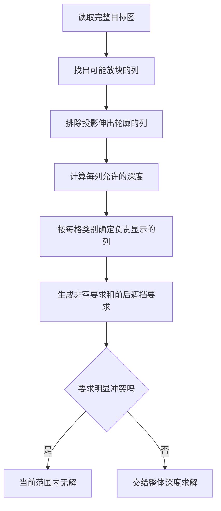
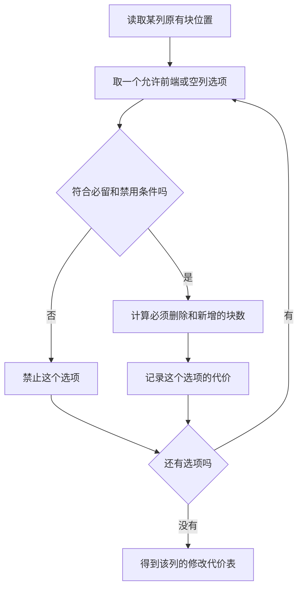
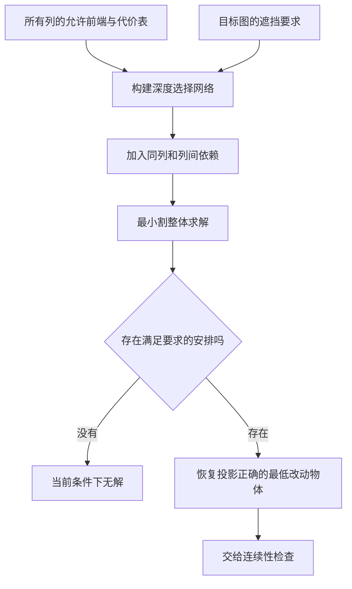
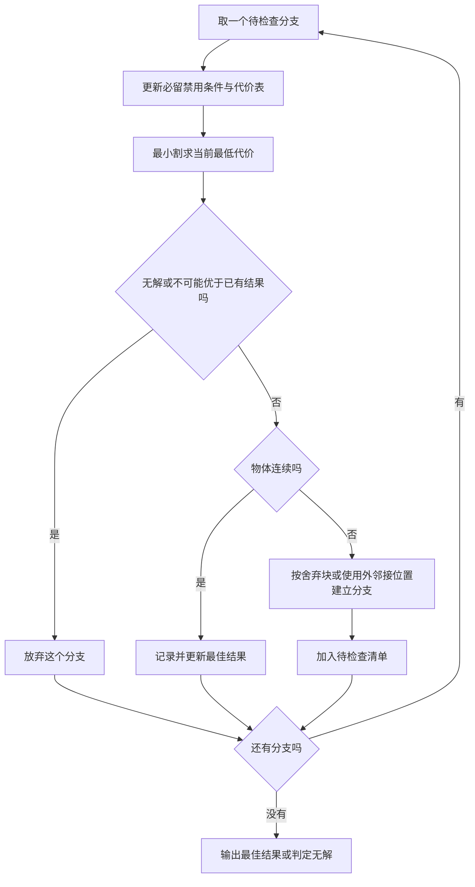
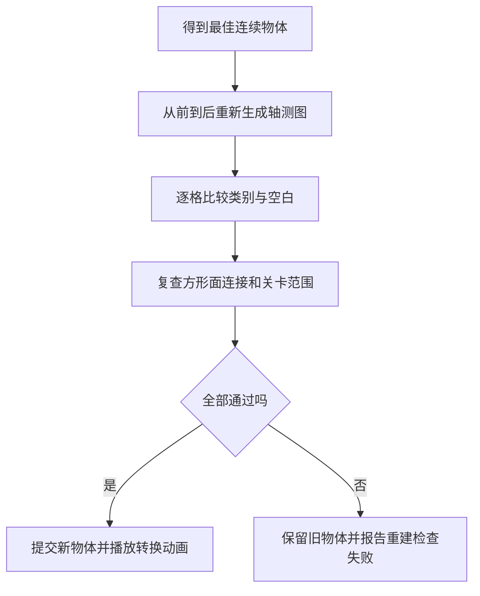
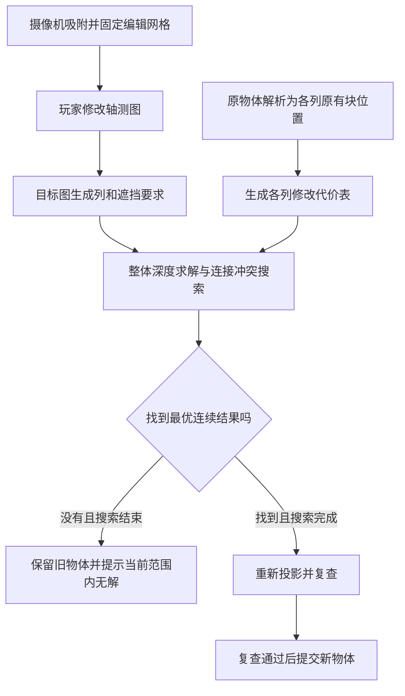

# 几何重建系统

## 一、系统目标与规则

玩家修改轴测图后，系统要找到一个新几何体：**投影与编辑图完全一致，所有立方体连成一体，而且相对原物体的总改动最少。** 总改动按“删除旧块数＋新增块数”计算，新增和删除一块的代价相同。

重建结果需要满足以下规则：

- **整张图一致。** 修改过的格、没有修改的格，以及轮廓外的空白，都必须符合目标图。
- **物体连续。** 通过完整的方形面连接才算相连，只碰到边或角不算。
- **范围固定。** 关卡规定允许放块的位置。文中的“无解”均指这个范围内无解。
- **只约束当前视角。** 摄像机吸附后才开始编辑；重建只要求当前视角符合目标图。
- **图的位置固定。** 编辑过程中不通过平移、缩放三角网格来寻找另一个匹配结果。

系统围绕“列的前端深度”求解，不需要先把整个关卡盒子填满，也不先生成所有几何体再逐个比较。

## 二、“立方体列＋深度”坐标体系

### 立方体列

沿当前视线前后移动一个立方体，它的投影位置可以保持不变。投影位置相同的这些位置，组成一条立方体列。

一个立方体的投影是节点周围的六个三角格。这个节点用于标识它属于哪一列；深度用于标识它在列中的哪个位置。每列最前面的块，会完全挡住同列后面的块。

不同列比较深度时，必须保留统一的三维参照。不能把每列各自的前端都记成零，再直接比较。

### “立方体列＋深度”坐标体系

| 数据 | 含义 |
| --- | --- |
| 列编号 | 它对应哪个投影节点 |
| 允许深度 | 关卡范围和禁区允许这列在哪些位置放块 |
| 原有块位置 | 原物体在这列的哪些深度有块，允许中间有空缺 |
| 原前端 | 原有块中最靠前的一块；原来没有块时记为空列 |
| 待求前端 | 新物体最前面的一块；部分列也可以选择为空 |
| 必留、禁用位置 | 连续性搜索中已经确定的条件 |

## 三、求解流程

### 1.从目标图直接生成遮挡关系

#### 核心逻辑

一个三角格只可能被三个相关立方体列覆盖，而这三列在该格提供的面类别各不相同。

因此，目标格的颜色能直接指定：**这个格必须由哪一列显示。** 遍历全部目标格，就得到整张图的遮挡要求。

#### 操作步骤

1. 从目标图覆盖到的网格点中，找出可能出现立方体的列。
2. 如果某列的六格投影有任何一格伸到目标空白处，禁止整列放块。
3. 把关卡范围、禁区转换成各列的允许深度。
4. 根据每个目标格的类别，找出负责显示它的列。
5. 要求负责显示的列非空，并生成它与另外两列的遮挡要求。
6. 合并重复要求。如果负责显示的列被禁止，或没有允许深度，直接判定无解。

不能只保留修改格直接涉及的列。完全隐藏的列也可能用于连接物体，必须保留其使用可能。

### 2.计算每个前端位置的修改代价

#### 核心逻辑

**先暂时不要求连续，算出某列选择一个前端时，最少需要增删多少块。**

#### 操作步骤

对每列的每个允许前端，按下面的规则计算：

1. 新前端之前的旧块必须删除。
2. 新前端处原本没有块，就新增一块。
3. 新前端后面的旧块保持原样，不主动新增隐藏块。
4. 选择空列时，删除该列全部旧块；负责显示目标格的列不能选择为空。

原物体中位于禁止列或不允许位置的旧块，无论选什么方案都必须删除。这部分计入固定改动，不能漏算。

#### 搜索的额外条件

连续性搜索会要求某些位置必须有块，或禁止某些位置放块。此时重新计算代价表：

- 前端不能位于任何必留块后面，前端位置本身也不能被禁用。
- 必留的新块即使藏在前端后面，也要计入新增数。
- 被禁用位置上的旧块，要计入删除数。
- 其他没有被限制的隐藏位置，仍保持原状。

每个位置只比较一次新旧状态，避免重复计算改动。这样，每份代价表都与当前搜索条件一致。

### 3.整体选择前端深度：最小割求解

#### 核心逻辑

**把所有列的深度选择放在一起计算，让遮挡要求全部成立，并使总代价最低。**

只考虑投影时，本题的“前端选择＋遮挡要求＋每列代价”可以构造成最小割问题，从一张带有依赖关系和修改代价的网络中，选出总代价最低的一组决定。

#### 操作步骤

1. 把各列的深度选择拆成“前端至少到达这个位置”的条件。
2. 同列条件相互关联：前端到达更前的位置，就一定也满足更后的深度门槛。
3. 把遮挡要求转换成列间依赖：B 前端到达某处时，A 前端就必须至少到达能挡住它的位置。
4. 加入每种前端选择的修改代价，并禁止不允许的选择。
5. 用最小割同时求解所有列，得到总修改代价最低的前端安排。
6. 按代价表恢复各列的块：使用选定前端，保留允许保留的旧块，并落实必留、禁用条件。

此时得到的是：**在当前条件下，投影正确的最低改动物体。它还不一定连续。**

这种将按列深度、依赖关系和代价转换成图优化的做法有现成理论可用；本题的具体遮挡关系和代价表按上述规则构造。[理论参考](https://pmc.ncbi.nlm.nih.gov/articles/PMC2834968/)

### 4.围绕连接冲突继续搜索

#### 核心逻辑

如果投影最优结果已经连续，它就是最终的全局最优解。如果它不连续，需要同时比较“补连接块”和“舍弃某些块”等选择。

**每个尝试分支都重新求解整张深度网络，允许其他列随之变化。**

#### 无漏解分支建立

1. 按三维方形面连接，把当前结果分成几团。
2. 选其中一团，在里面选一块 U；再从其他团选一块 V。
3. 找出与所选这一团共面相邻、当前没有块、但关卡允许放块的所有位置。
4. 分别建立以下分支：
   - 禁用 U 所在位置。
   - 禁用 V 所在位置。
   - 对每一个外邻接位置，分别要求该位置有块。
5. 与已有必留、禁用条件冲突的分支，直接跳过。

为什么这些分支不会漏掉正确结果：一个连续结果如果仍保留 U、V，连接路径就必然经过所选团的某个外邻接位置；如果没有这样的连接位置，就至少要舍弃 U、V 中的一块。

这里是对每个外邻接位置分别尝试，不是把周围一圈全部补满。连接没有完成时，后续检查会继续产生分支。

#### 低价值分支跳过

每个分支先更新必留、禁用条件和代价表，再运行最小割。

此时算出的最低代价，就是这个分支即使暂不要求连续，也至少需要的改动数。

- 分支无解，直接放弃。
- 已经找到总代价更低的连续结果，就不用继续检查。
- 如果分支结果仍然断开，继续围绕新的断开处建立分支。
- 如果已经连续，记录为有效结果，并在更便宜时更新当前最佳结果。

全部分支都已完成或不可能更优时，当前最佳结果就是最少改动的连续物体。没有找到任何连续结果，则当前关卡范围内无解。

这一阶段仍可能需要组合搜索，不能承诺整个系统只遍历一次。它的搜索由实际连接冲突触发；各列之间的遮挡联动，交给每次最小割整体处理。

### 5.结果复查与确定性

#### 投影复核

按当前吸附视角，把结果中的立方体从前到后排列。每块提供六个三角格，已经被前方块占据的格不再改写。

把生成的整张图与编辑图逐格比较，同时再次确认物体连续、没有超出允许范围。全部通过后，才提交新物体。

#### 多解选择

总改动相同的，采用固定搜索顺序中最先找到的结果。列编号、深度选项、最小割并列处理、连接分支顺序都要固定，不能依赖随机遍历。

在只比较总改动的规则下，某分支最低代价已不小于当前最佳结果时，可以跳过；已有结果保留并列优先权。

由此保证：

- 相同原物体、目标图、视角、允许范围，总得到相同结果。
- 原物体本身合法且位于范围内时，不改图就以零改动还原原物体。
- 在允许范围内找到的是新增数与删除数之和最少的连续结果。
- 只有完成必要分支检查，才能称为全局最优；中途停止时，即使已有有效结果，也尚不能保证最优。

## 四、完整操作链

