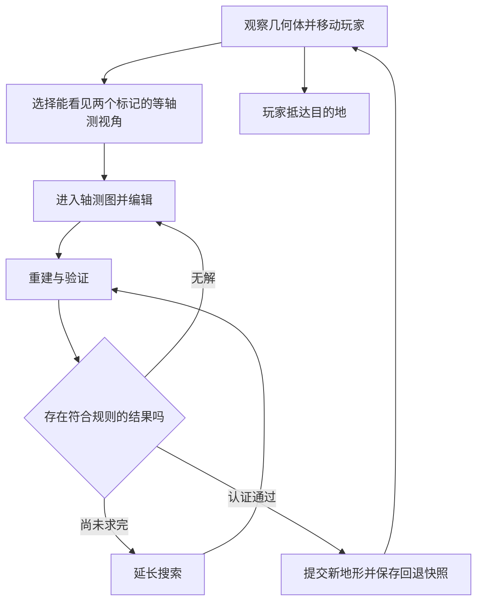

# 等角轴测视错觉解谜游戏策划案

## 一、游戏概念

一款以正等轴测投影与立体深度歧义为核心的空间解谜游戏。

玩家观察体素构成的几何体，将其转换为可编辑的三角网格轴测图，再通过改色、增加和删除三角格重建地形。玩家在变化后的顶面行走，寻找抵达目的地的路径。

核心体验是观察空间关系、预测重建结果，并组合视角、站位和地形变化完成解谜。

## 二、核心操作循环

**观察与行走 → 选择视角和站位 → 进入轴测编辑 → 修改三角格 → 重建几何体 → 检查新通路并继续行动。**

一次完整转换从进入编辑开始，到成功提交新几何体结束。

## 三、几何体编辑与重建

### 两种交互状态

| 状态 | 显示与操作 |
| --- | --- |
| 几何体状态 | 显示实体表面与折边，拖动观察，松手吸附到四个上方正等轴测视角之一，玩家沿顶面移动 |
| 轴测编辑状态 | 显示三角网格与标记，固定编辑视角，通过改色、增加、删除修改目标图，可缩放和平移画布观察 |

画布缩放和平移只改变显示位置，网格与三维坐标的对应关系固定。照明保持在屏幕左上方向，三个面类别使用清晰可辨的颜色。

### 编辑

- 每格数据状态为空白、上、左、右之一，三种颜色表示面的朝向。
- 改色、增加、删除共用每轮十次有效编辑额度。无变化操作不计数，撤销返还额度。
- 增加和删除可以改变投影轮廓，操作范围由关卡限制。
- 成功重建后恢复下一轮额度。整关转换次数另行统计。

### 重建

新几何体必须符合以下条件。

1. 当前视角的投影与完整目标图一致，包括所有空白区域。
2. 全部体素通过完整方形面连成一体，并位于关卡允许范围内。
3. 玩家与目的地的支撑位置、顶面朝向和可见性符合保护规则。
4. 相对进入本轮前的几何体，新增块数与删除块数之和最少。同代价结果采用固定选择规则。

几何体到轴测图的投影由几何体和视角确定。重建同时依赖原几何体、目标图和关卡条件。相同输入得到相同结果。

重建无解时保留编辑内容供调整。搜索额度耗尽时显示尚未完成判断，并提供继续搜索。正式关卡认证使用已证明最优的结果。

### 撤销与存档

编辑状态支持逐次撤销。几何体状态支持按快照撤销完整转换，恢复几何体、视角、玩家和目的地。

取消编辑恢复进入本轮前的几何体与标记，并采用两个标记可见的视角退出。白模存档保存当前状态及转换历史。

## 四、玩家与目的地

- 两者记录在各自支撑体素的朝上面上。白模初始位置随机生成。
- 玩家在几何体状态下沿水平四邻方向移动。
- 进入和退出轴测编辑时，两处支撑顶面必须真实可见。
- 进入时自动寻找能同时看见两个标记的吸附视角。没有可用视角时，提示玩家先调整站位。
- 编辑期间两者的位置固定，支撑顶面的三角格受到保护，重建结果也要通过实际遮挡检查。
- 关卡求解以玩家抵达目的地为完成条件。当前白模将目的地作为标志，到达后可以继续移动。

玩家站位会改变受保护位置，因此行走与编辑可以共同构成解法。

## 五、关卡与教学设计

关卡围绕明确的打法组织教学，再逐步加入视角和站位的组合。首批方向包括局部凹凸变化、换面改造、站位作锚和跨视角接力，具体成立条件由引擎验证。

关卡制作采用“逆向生成带解候选、正向求解检查捷径、人工筛选改良”的流程。正式谜题要求初始无法只靠行走完成，并保留可回放的解法。

评价重点为教学集中度、步骤依赖、空间反馈、关键打法必要性及替代解质量。整关转换上限、总编辑预算和局部编辑限制作为待验证的设计选项。