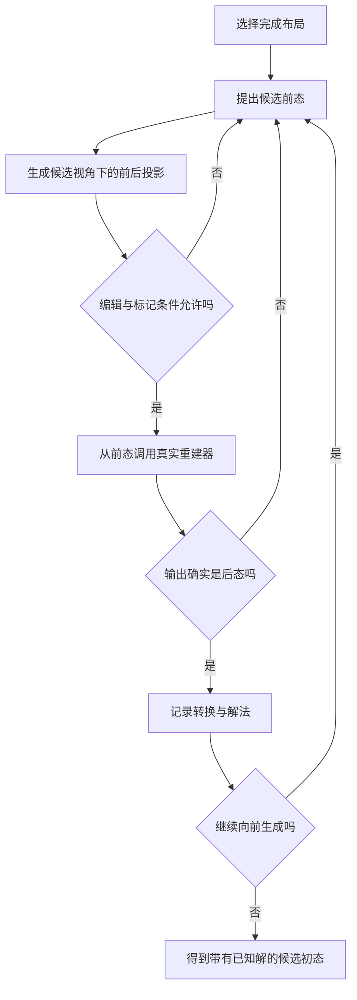
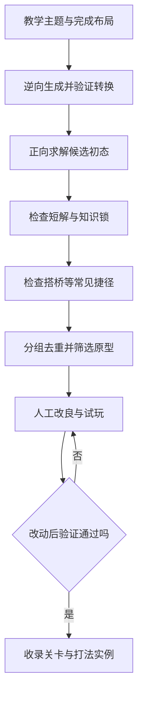

# 谜题设计策划

## 一、设计目标

围绕“观察几何体、修改轴测图、重建几何体、改变玩家通路”设计关卡，让玩家逐步掌握规则衍生出的打法，并在后续关卡中组合运用。

采用以下工作流程。

**确定教学主题 → 逆向生成可解候选 → 正向求解检查捷径 → 筛选原型 → 人工改良 → 再次验证。**

逆向生成负责提供带有已知解的素材。正向求解负责检查实际解法。试玩负责判断线索、反馈和学习过程是否清楚。

本文件中的生成器、打法库和筛选方法属于待开发方案。当前白模已提供投影、编辑、重建、行走与标记保护，可作为验证基础。

## 二、分析问题时使用的规则

- 关卡具有有限的允许体素范围。
- 每次进入编辑前，摄像机吸附到四个上方正等轴测视角之一。
- 三角格有空白、上、左、右四种数据状态。玩家通过增加、删除、改色改变状态。
- 每轮最多十次有效编辑，撤销会返还额度。成功重建后开始新的一轮。
- 重建必须符合整张目标图、空白区域、体素共面连续和标记保护要求。
- 引擎选择相对原物体新增数与删除数之和最少的结果。同代价结果按固定规则选择。
- 玩家在实体状态下沿顶面行走。编辑期间，玩家和目的地的支撑位置固定，顶面保持可见。
- 关卡求解以玩家到达目的地为完成条件。白模中的目的地目前只显示标记，玩家到达后可以继续活动。

每轮编辑额度限制一次转换的操作量。整个谜题的转换次数另行统计。

## 三、谜题定义-状态图

### 1. 状态

一份状态记录几何体、玩家位置、目的地位置和当前视角。关卡范围及其他固定条件作为该关卡的规则保存。

不能仅按当前轴测图合并状态。外观相同的几何体，其隐藏结构和后续操作可能不同。玩家具体站位也需要保存，因为站位决定了受保护的顶面。

### 2. 操作

| 操作 | 状态变化 | 验证内容 |
| --- | --- | --- |
| 行走 | 玩家移动到相邻顶面 | 使用游戏实际的落脚规则 |
| 换视角 | 切到另一观察方向 | 编辑前满足吸附与标记可见要求 |
| 完整转换 | 编辑图并重建出新几何体 | 编辑额度、完整投影、连续性、标记保护和真实重建结果 |

每条经过验证的操作构成一条有向边。求解就是从初态寻找一条到达目的地的路径。

### 3. 解法代价

优先比较完整转换次数，再比较三角格编辑次数。切换视角次数和行走量作为辅助分析指标。

单次重建的最少体素增删由引擎负责。整个谜题的最短解需要在状态图中搜索。

同一轮中，得到相同最终编辑图的不同操作顺序可以合并。前后图中状态不同的三角格数量，就是直接完成这份编辑所需的最少操作数。受保护格和允许编辑范围仍需检查。

## 四、逆向生成可解初态

### 1. 选择完成布局

先设计一份玩家已经能够走到目的地的几何体，把玩家放在通路起点，目的地放在终点。生成过程从这份布局向前寻找初态。

完成条件可以对应多种几何体。固定一份完成布局只是生成起点。

### 2. 寻找经过验证的前态

对于当前后态 B，按以下步骤提出前态 A。

1. 在 B 的局部尝试改变体素，得到候选 A。
2. 选择一个候选视角，分别生成 A、B 的投影。
3. 检查两图的差异是否在十次编辑以内，并符合允许编辑与标记保护规则。
4. 以 A 为原物体、B 的投影为目标图，调用真实重建器。
5. 只有重建结果确实为 B，才记录 A 到 B 的合法转换，以及对应视角和编辑内容。
6. 将 A 作为新的后态继续生成。

两份几何体各自合法，并不能保证从 A 提交 B 的投影就会得到 B。若 A、B 在某视角下投影相同，提交该图会以零改动保留 A。因此，前态验证必须调用游戏实际使用的选解规则。

涉及玩家站位变化时，还要记录行走步骤，并逐步验证正向行走。生成初态后，要求玩家尚未到达目的地，且无法只靠行走完成。

逆向搜索生成可解初态，并结合难度和新颖性评价，已有相应研究。本项目在每条转换上增加确定性重建验证。[相关研究](https://ijcai.org/proceedings/2019/646)

### 3. 验证实际最短解

逆向记录提供一条已知解。随后从初态重新进行正向搜索，检查更短的路径、其他完成布局和常见捷径。

生成路径有五次转换，不代表实际需要五次。初始已能走到目的地、无效往返和可以直接跳过的中间态，都应在这一步识别。

## 五、打法库

### 1. 打法的记录方式

每种打法记录触发条件、可执行编辑、实际重建结果、通路或遮挡效果，以及不成立的条件。

打法实例需要保留必要背景。相同局部颜色修改放入另一份几何体后，最少增删规则可能选择另一个结果。

### 2. 第一批待验证的打法候选

| 打法候选 | 玩家理解的关系 | 预期关卡作用 |
| --- | --- | --- |
| 凹凸翻转 | 面类别改变会重新解释局部体积 | 创建踏脚、降低台阶或打开缺口 |
| 前后错位 | 投影位置与实际深度的关系 | 让可走面接上另一段平台 |
| 换面改造 | 不同视角暴露不同结构 | 处理原视角难以修改的位置 |
| 跨视角接力 | 一次改造为另一视角创造条件 | 形成有先后依赖的多阶段解法 |
| 站位作锚 | 玩家脚下顶面受到保护 | 先走到合适位置，再改造周围 |
| 暂时让路 | 一次操作的价值可能在后续出现 | 先改变已有通路，再完成连接 |
| 一次编辑影响两处 | 局部遮挡改变会牵连其他列 | 同时改变两处通路或可见性 |
| 改造隐藏结构 | 换视角后可以修改原视角遮住的部分 | 让外观相近的状态具有不同通路 |

这些名称用于组织发现，成立范围由真实重建实例确定。

### 3. 自动发现打法

批量采集合法转换，记录体素增删、顶面变化、可达区域变化、遮挡变化，以及玩家站位对结果的影响。

把效果相近的转换聚类，挑选小而清楚的实例，人工命名并补充触发条件。

局部模式可以做水平旋转和平移归一。整关去重时，同步处理边界、标记和视角。

## 六、用反事实验证知识锁

希望关卡教授某种打法时，同时运行完整求解器和能力受到限制的模拟玩家。

| 模拟玩家 | 检查问题 |
| --- | --- |
| 只会直接增加踏脚或搭桥 | 基础建造能否绕过设计 |
| 只使用初始视角编辑 | 换视角是否必要 |
| 始终原地编辑 | 玩家是否需要先移动站位 |
| 只接受立即扩大可达区域的操作 | 是否需要准备步骤或暂时让路 |
| 只掌握此前教过的打法 | 本关是否引入了新的知识 |

记录限制前后的可解性和最少转换次数。限制后无解，说明相应能力在该分析模型内必需。限制后仍可解但显著变长，可以作为需要高效运用该知识的关卡。

检查打法必要性时，要识别实现同样效果的组合操作。仅禁止一个模板名称，会漏掉等价用法。

动作只来自模板采样时，结论应注明已覆盖的动作和搜索深度。完整动作范围下的求解证据，才能支持该范围内无捷径的判断。

能力受限智能体已被用于生成需要特定操作知识才能通过的教学关卡。[相关研究](https://arxiv.org/abs/1807.06734)

## 七、批量生成与筛选

### 1. 生成流程

1. 选定教学主题、允许范围和预计转换深度。
2. 选取或设计完成布局。
3. 逆向提出前态，逐条正向验证，保留已知解。
4. 从候选初态重新求解，找出短解和替代解。
5. 运行知识锁与常见捷径检查。
6. 按几何布局和关键解法去重、分组。
7. 人工挑选原型，调整线索、结构和视觉表达。
8. 改良后重新求解，再进行试玩。

### 2. 硬性筛选条件

- 初始无法只靠行走完成。
- 存在经真实引擎回放的完整解法。
- 每轮操作符合编辑额度、连续性和标记规则。
- 每次转换对解法有实际作用。
- 关键打法具有可辨认的条件和效果。

### 3. 原型评价维度

| 维度 | 关注内容 |
| --- | --- |
| 教学集中度 | 新知识是否集中在少量关键结构中 |
| 步骤依赖 | 前一步是否为后一步创造必要条件 |
| 跨视角需求 | 不同视角是否承担不同推理任务 |
| 站位需求 | 行走是否参与编辑规划 |
| 解法结构 | 合理变体是否保留核心思路 |
| 反馈清晰度 | 操作后能否看清变化及其原因 |
| 重建稳定性 | 同代价重建是否造成难以预测的通路差异 |

优先保留关键思路明确的关卡。独立操作交换顺序，可以归为同一种解法结构。

关键步骤检查同代价的其他重建结果。优先选择结果唯一，或不同结果都保留预期通路效果的实例。

关卡评价需要结合模拟游玩与玩家实验，计算难度和玩家感知难度应分别记录。[相关研究](https://cdn.aaai.org/ojs/12859/12859-52-16375-1-2-20201228.pdf)

### 4. 最小记录单元

每个原型保存初态、标记、边界、规则版本、已知解、短解、关键打法、捷径检查范围和试玩记录。每次转换保存视角、目标图以及认证的重建结果。

## 八、当前规则下的重点验证

### 自由搭桥是否形成普遍捷径

新增一块体素最多影响其投影中的六格。当前每轮允许十次编辑，且成功转换后恢复额度，因此部分布局可能允许逐块增加踏脚通过。

先用只会搭桥的模拟玩家测试候选集。若大量关卡都被绕过，再依据教学目标选择整关转换次数、总编辑额度或局部可编辑区域等约束。这些属于待验证的关卡规则。

### 随机白模与正式谜题的初态

当前白模会优先把目的地放在玩家已经可达的顶面上。正式生成器应筛选初始不可达的目的地布局。

### 重建认证

生成与回放采用固定版本、固定并列规则和已证明最优的重建结果。白模允许手动采用未证明最优的有效解，该调试选项在正式关卡规则中需要另行确定。

### 几何连续与玩家通路

所有候选均满足体素共面连续。关卡仍可以通过高度差、侧面连接或下部结构，使玩家暂时无法到达另一片顶面。生成时分别检查实体连接和实际行走路径。

## 九、首批原型计划

从十几个可变体素位置、少量转换的小实验关开始，固定背景和标记条件。

| 阶段 | 原型方向 | 验收目标 |
| --- | --- | --- |
| 基础发现 | 一次局部顶面重构接通通路 | 核心变化清楚，基础捷径可控 |
| 迁移运用 | 换视角处理类似结构 | 原视角的简单操作不能直接替代 |
| 站位参与 | 先走到中间平台再编辑 | 站位改变实际可用操作 |
| 组合解法 | 站位与跨视角操作连续配合 | 存在明确先后依赖，并通过短解检查 |

用这些实例建立第一版打法库，再决定关卡规模、教学顺序和难度分层。

## 十、关联文档

- 游戏整体规则与开发范围见 [等角轴测视错觉解谜游戏策划案](等角轴测视错觉解谜游戏策划案.md)。
- 重建算法的详细流程见 [几何重建系统](几何重建系统.md)。
